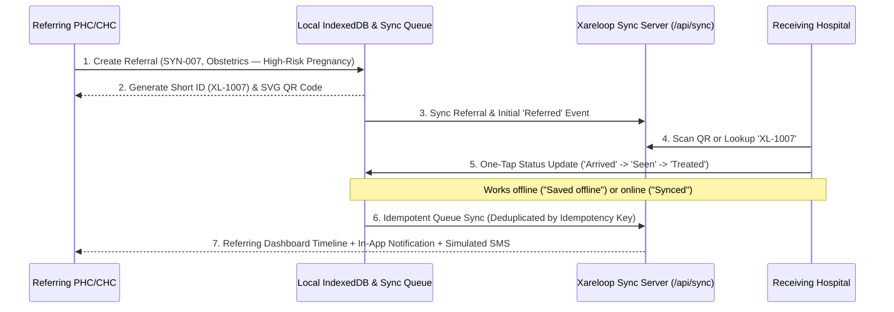

# Xareloop — Architecture Diagram & Synchronization Topology

## 1. High-Level System Architecture

```
+-----------------------------------------------------------------------------------+
|                        CLIENT NODE (Mobile / Desktop PWA)                         |
|                                                                                   |
|  +-----------------------+   +------------------------+   +--------------------+  |
|  | Referring PHC/CHC UI  |   | Receiving Facility UI  |   | Dashboard Metrics  |  |
|  | - Create Referral     |   | - QR / Short ID Lookup |   | - 5 Core KPIs      |  |
|  | - Primary/Sub Cat     |   | - 1-Tap Status Buttons |   | - Simulated SMS    |  |
|  | - QR / Handover Slip  |   | - Timeline View        |   | - Auth Switcher    |  |
|  | - In-App Alerts       |   +-----------+------------+   +---------+----------+  |
|  +-----------+-----------+               |                          |             |
|              |                           |                          |             |
|              +---------------------------+--------------------------+             |
|                                          |                                        |
|                                          v                                        |
|                     +-----------------------------------------+                   |
|                     | Pure Domain Engine (referralEngine.ts)  |                   |
|                     | - Synthetic Code Validation (SYN-XXX)   |                   |
|                     | - Short ID & SVG QR Generator           |                   |
|                     | - Idempotent Offline Sync Deduplicator  |                   |
|                     +--------------------+--------------------+                   |
|                                          |                                        |
|                    +---------------------+---------------------+                  |
|                    |                                           |                  |
|                    v (Always Available)                        v (When Online)    |
|     +------------------------------+            +------------------------------+  |
|     | IndexedDB (indexedDb.ts)     |            | REST Sync Client (api.ts)    |  |
|     | - Store: referrals, events   |            | - GET /api/state             |  |
|     | - Store: sync_queue, notifs  |            | - POST /api/sync             |  |
|     | - Service Worker Asset Cache |            | - BroadcastChannel Multi-Tab |  |
|     +------------------------------+            +--------------+---------------+  |
+----------------------------------------------------------------|------------------+
                                                                 |
                                                                 | HTTP / JSON
                                                                 v
+-----------------------------------------------------------------------------------+
|                     BACKEND NODE (server.ts — Express + Vite)                     |
|                                                                                   |
|  - Idempotent State Merge (/api/sync)                                             |
|  - Real-Time Multi-Node State Store (referrals, events, notifications, sms_logs)  |
|  - Prototype Facility Authentication (/api/auth/login, /api/auth/register)        |
+-----------------------------------------------------------------------------------+
```

## 2. End-to-End Referral Lifecycle Diagram (Mermaid)


